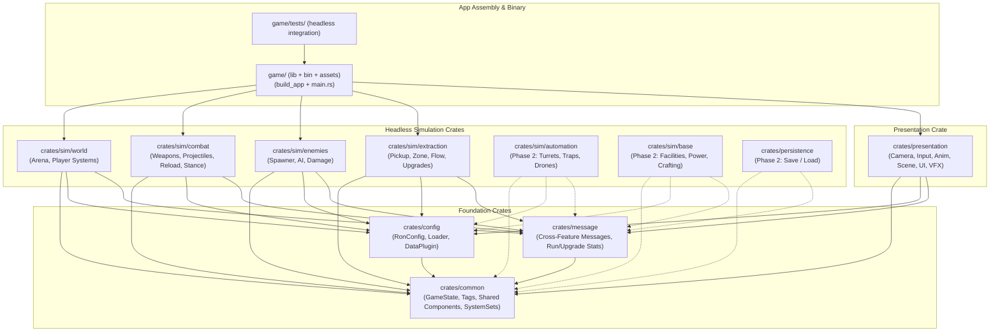

## Context

The workspace initially used 7 crates (`data`, `world`, `combat`, `enemies`, `extraction`, `presentation`, `core`) in `game/Cargo.toml`.
Stage 1 completed the immediate refactoring of monolithic files into nested sub-features under 500 lines using standardized 1-word filenames.

To scale the architecture for large-scale development (7 zombie archetypes, biomes/chunks, deployables, home base, save/load, and co-op multiplayer), Stage 2 addresses structural coupling, build parallelization, asset organization, and testability.

## Goals / Non-Goals

**Goals:**
- Decompose the `data` god-crate into `common` (leaf types), `config` (generic loader), and `message` (cross-crate events/progression).
- Decouple `presentation` from individual simulation crates so rendering/animation queries shared ECS data rather than importing sim logic.
- Replace fragile cross-crate system function ordering with explicit `SystemSet` contracts.
- Move `Cargo.toml` and `crates/` to the repository root, making `game/` the runnable app crate (`build_app()`, `main.rs`, `tests/`, and `assets/`).
- Organize `game/assets/` by domain folders (`config/<domain>/...`, `models/<domain>/...`).
- Pre-plan Phase 2 crate boundaries (`crates/sim/automation/`, `crates/sim/base/`, `crates/persistence/`).
- Feature-flag dev-only dependencies (`bevy-inspector-egui`, dynamic linking).
- Keep all Rust source files under 500 lines with 1-word naming.

**Non-Goals:**
- Changing runtime gameplay mechanics, physics simulation, or enemy balance.
- Implementing Phase 2 gameplay features (deployables, base progression, persistence) ahead of schedule; only define the structural crate and layout boundaries.
- Splitting `presentation` into multiple Cargo crates prematurely before presentation compile times warrant it.

## Decisions

### D1. Two-Layer Cargo Boundary (`crates/sim/` vs `crates/presentation/`)
- **Choice:** Retain `crates/sim/<feature>/` feature crates and a single `crates/presentation/` leaf crate.
- **Rationale:** Simulation crates stay headless-capable, while editing presentation/UI never triggers downstream recompiles in simulation crates.

### D2. Nested Sub-Features with Standardized 1-Word Files in `crates/sim/`
- **Choice:** Each `sim/<feature>/src/` crate splits into nested sub-feature folders using standardized 1-word file names (`mod.rs`, `config.rs`, `state.rs`, `event.rs`, `system.rs`, plus `tests.rs` where needed). Only the files a sub-feature actually uses are created.
- **Rationale:** Prevents any file from exceeding 500 lines and makes navigating features intuitive and uniform.

### D3. Two-Tier Event Placement
- **Choice:** Cross-feature typed Bevy messages remain in a shared event layer (`message` crate), while events produced and consumed solely within a single feature live in `<subfeature>/event.rs`.
- **Rationale:** Prevents circular dependencies while avoiding polluting the shared message layer with feature-internal signals.

### D4. Concern-First `crates/presentation/` with Feature Sub-Modules in `scene/` and `ui/`
- **Choice:** Keep `presentation` organized by visual concern: `camera/`, `input/`, `anim/`, `vfx/`, `audio/`, `scene/`, `ui/`. Subdivide scaling concerns (`scene/` and `ui/`) by feature or screen.
- **Rationale:** Preserves shared visual pipelines while preventing monolith files as more biomes, enemies, and screens are added.

### D5. Public Crate Re-Exports & System Ordering Preservation
- **Choice:** Keep each crate's root `lib.rs` re-exporting its public plugins, components, configs, and system sets.

### D6. Tripartite Split of `data` (`common`, `config`, `message`)
- **Choice:** Split the monolithic `data` crate into:
  1. `crates/common/`: `GameState`, `SimUpdateSet`, `SimPostPhysicsSet`, collision groups (`GROUP_WORLD`..`GROUP_PICKUP`), entity tags (`SurvivorTag`, `EnemyTag`, `ObstacleTag`, `RunEntity`), shared enums (`EnemyKind`, `UpgradeKind`), and shared queryable components (`Survivor`, `Health`, `MovementStats`, `AimDirection`, `WeaponInventory`, `CombatStance`, `Enemy`, `ExtractionZone`, `ScrapPickup`).
  2. `crates/config/`: `RonConfig` trait, `RonAssetLoader<T>`, `DataPlugin`, `ConfigSyncSet`, `PendingConfigs`, `ConfigHotReloadedMessage`, and `assert_ron_config_parses!`.
  3. `crates/message/`: Cross-feature Bevy `Message` definitions and shared progression/outcome resources (`RunStats`, `ScrapBank`, `LastRunOutcome`, `UpgradeLevels`, `UpgradeModifiers`).
- **Rationale:** Prevents recompiling every crate whenever a message or config helper is edited. `common` becomes a stable leaf crate.

### D7. Decoupled Presentation via Shared Component Queries
- **Choice:** `presentation` depends on `common`, `config`, and `message`, but **NOT** on `world`, `combat`, `enemies`, or `extraction`.
- **Rationale:** In ECS, components represent data and systems represent behavior. Presentation only needs to query component data to drive meshes, animations, HUD, and VFX. Eliminating the dependency on sim crates isolates presentation compile cycles and guarantees simulation crates can be rewritten without breaking presentation imports.

### D8. Contract-Based System Ordering via `SystemSet`s
- **Choice:** Replace direct function imports across crates (e.g. `combat` depending on `world::player::apply_player_damage`) with cross-crate `SystemSet`s defined in `common` (e.g. `PlayerDamageSet`, `ProjectileCollisionSet`).
- **Rationale:** Decouples crate internals so system functions can be refactored or made private without breaking sibling crate schedules.

### D9. Root Workspace & Unified `game/` Crate (`src/lib.rs` + `src/main.rs`)
- **Choice:** Place the Cargo workspace at the repository root (`Cargo.toml` + `crates/`), and use `game/` as the unified app crate exposing `pub fn build_app() -> App` in `game/src/lib.rs` and keeping `game/src/main.rs` as:
  ```rust
  fn main() {
      game::build_app().run();
  }
  ```
- **Rationale:** Eliminates nested `game/crates/...` paths, keeps `crates/` alongside `docs/` and `openspec/`, and places `game/assets/` directly beside `game/Cargo.toml` so Bevy's `AssetPlugin` resolves assets natively without environment overrides while supporting headless tests in `game/tests/`.

### D10. Domain-Grouped Asset Hierarchy (`game/assets/`)
- **Choice:** Keep assets in `game/assets/`, organized by domain:
  - `config/`: `player/`, `combat/`, `enemies/`, `world/`, `extraction/`, `base/`
  - `models/`: `player/`, `enemies/`, `weapons/`, `world/`
  - `audio/`: `sfx/`, `music/`
  - `texture/`: `materials/`, `ui/`
- **Rationale:** Matches Bevy defaults and prevents hundreds of flat asset files as Phase 1–3 content expands.

### D11. Feature-Gated Dev Tools & Test Harness
- **Choice:** Move `bevy-inspector-egui` and `dynamic_linking` behind a `dev` cargo feature in `game/Cargo.toml`. Provide headless integration tests in `game/tests/` running game loops against `game::build_app()`.

---

## Target Architecture Graph



---

## Risks / Trade-offs

- **[Risk] High crate count overhead:** Creating `common`, `config`, `message`, and `game` adds 4 `Cargo.toml` files.
  - *Mitigation:* Cargo workspace inheritance (`[workspace.dependencies]`) keeps individual `Cargo.toml` files minimal (5–15 lines each).
- **[Risk] Component migration churn:** Moving shared components (`Survivor`, `Health`, `WeaponInventory`, etc.) to `common` touches imports across multiple crates.
  - *Mitigation:* Re-export them from their original module/crate roots during migration to preserve backward compatibility until all crates are updated.
- **[Risk] Asset path changes breaking tests:** Changing `.ron` paths to domain subfolders could break existing tests.
  - *Mitigation:* Update `RonConfig::PATH` and the asset directories in one atomic step and run parse tests immediately.
